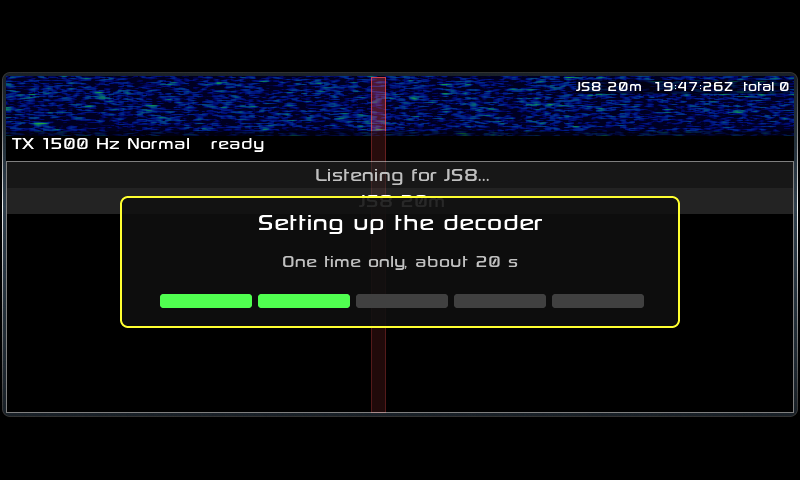
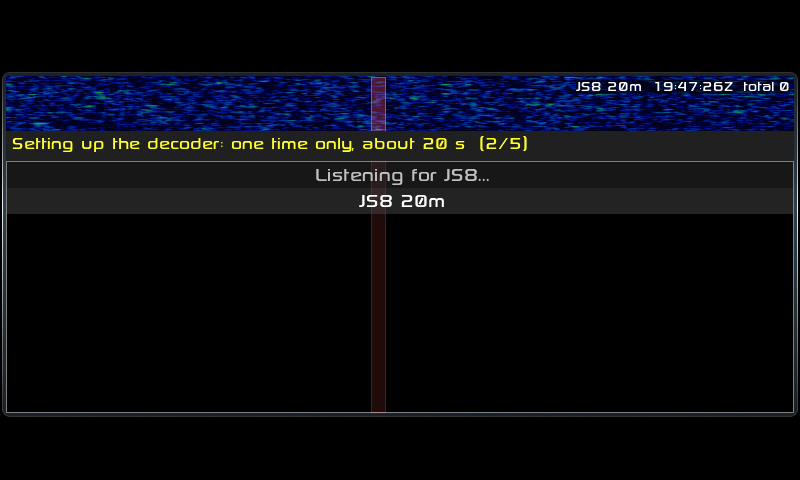
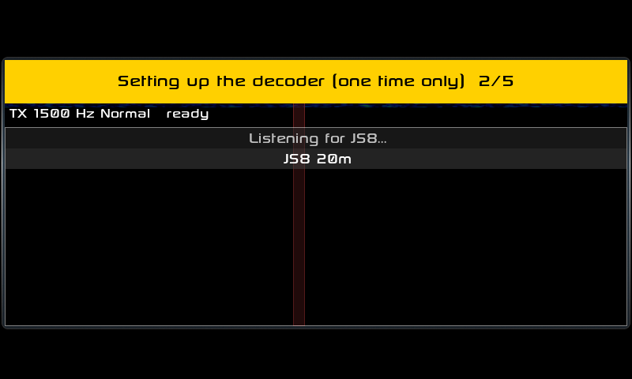

# Decoder setup notice: mock-ups

The one-time notice JS8 shows while it measures the decoder's FFT plans
(first open of a new build, or `js8_wisdom.dat` deleted). Drawn with LVGL
and the radio's own fonts over a live JS8 screen in the UI harness
(`ONLY_SETUPMOCK=1`), at the radio's pixel positions (800 x 480).

| | |
|---|---|
| **A, the box** (recommended, built) |  |
| B, in the TX bar |  |
| C, a banner over the waterfall |  |

- **A**: a box in the middle of the list. Title in 30 px type, a line
  saying it happens once, and five segments that fill as each speed is
  measured, so you can see it moving. Easy to read at arm's length, and
  plainly a temporary notice, not a fault. The waterfall keeps running
  above it.
- **B**: the TX bar says it, in yellow. Takes no extra room, but it's
  22 px type in a place that always shows something, so it's easy to miss.
- **C**: a yellow banner over the waterfall strip. Hard to miss, but it
  hides the waterfall and looks like a warning.

Recommended: **A**. VE7NHW picks before anything merges.

`harness_a_built.png` is A as the app now draws it (`ONLY_SETUP=1`, the
second open while the setup is still running, two speeds done).
