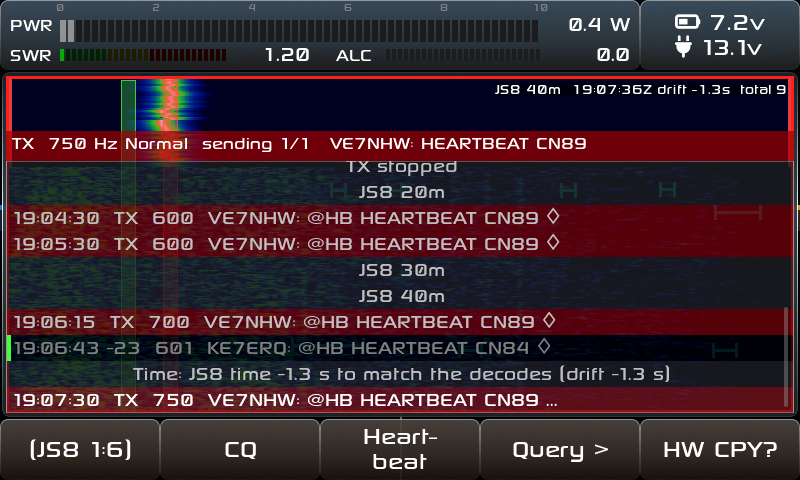

A bigger, easier-to-read TX meter that no longer hangs over the spectrum or an app's waterfall.

*On my X6100 during a JS8 heartbeat (0.4 W into a dummy load), test image of 30cc2679. The red edge on the waterfall is JS8's own TX rows, not part of this PR.*

**What changes**
- The TX box was `TOP_BLOCK_BIG_HEIGHT` (126 px) tall. The apps' top bar is 70 px, so in every app that transmits (FT8, JS8, RTTY, ...) it hung 56 px over the waterfall, and on the main screen over the top of the spectrum. It is now the small top bar's height (70 px).
- During TX the frequency dial hides (as the S-meter already does) and the meter takes both boxes' room, 640 px:
  - **PWR**: one thick LED bar under a 0–10 W scale, with a peak tick held 1 s that then falls, and the big W number on the right.
  - **SWR** and **ALC**: thinner bars below, each with its number as big as the power's (sony_26).
- Colours are the stock meter's: PWR grey, SWR green up to 2, yellow up to 3, red above (the **SWR colour: gray** setting still works), ALC grey. Lit LEDs at 80 % as the stock bars, unused ones shown dimmed so the length of each scale is visible.
- ALC now always has its own bar. Its number follows **Show meter value**, like PWR and SWR. The big "ALC: x.x" message (Mag ALC) is unchanged.
- **CW:** the radio goes TX/RX at every pause in the keying, so in CW and CW-R the meter stays up until 1 s after the last element; otherwise the dial would blink while keying. In other modes the dial comes back as soon as TX ends.

**How it works**
- `src/tx_info.c`: the bars are drawn by a draw callback (LED segments; `lv_bar_indicator` can't draw the dimmed unused LEDs). The peak falls by time, not by packet.
- `tx_info.c` sends two new messages, `MSG_TX_INFO_SHOW` / `MSG_TX_INFO_HIDE` (`src/pubsub_ids.h`). The S-meter (`meter.c`) and the dial (`freq_info.cpp`) follow those instead of `MSG_RADIO_TX/RX`, so all three swap together, including the CW hold.
- `src/styles.c`: the box is `METER_WIDTH + FREQ_INFO_WIDTH` wide and `TOP_BLOCK_SMALL_HEIGHT` tall.

**Not changed, but worth knowing:** in `radio.c`, `RADIO_ATU_RUN` sends `MSG_RADIO_RX` only when `atu_status && !tx`. If a tune ever ended without `atu_status`, the state would stay in `RADIO_ATU_RUN`. With the stock meter the S-meter then stayed hidden; with this one the dial would too. Nobody has reported it, so I left `radio.c` alone.

**Testing**
- On my X6100 (test image of 30cc2679): the meter on the main screen and in FT8 and JS8, the stock colours, split / VFO B (the dial comes back right). I'm happy with how it looks.
- I ran a code review on the branch and fixed what it found (276517fa, ca0313c4): no stale bars from the last transmission at TX start, the peak falls by time, the SWR colour setting read once per redraw, the dead Mag ALC hook removed, and the CW hold. These two commits are compile-checked with the image's GCC 12 but not yet run on the radio: test image in progress.

🤖 Generated with [Claude Code](https://claude.com/claude-code)
